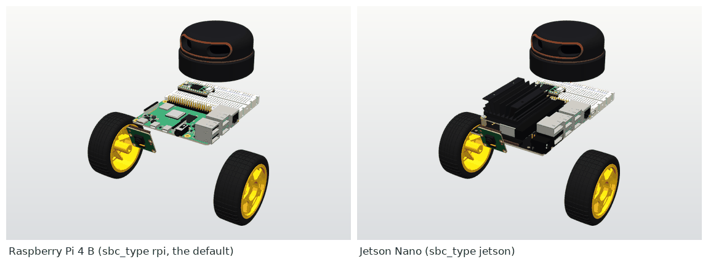

# remo_description

ROS URDF description package of REMO robot (Research Education Mobile/Modular robot) a highly modifiable and extendable mobile robot based on [Nvidia's Jetbot](https://github.com/NVIDIA-AI-IOT/jetbot). The meshes of Remo's purchased parts, such as the laser scanner and the Raspberry Pi, come from the public package [robot_component_models](https://github.com/ros-mobile-robots/robot_component_models). The STL files to 3D print Remo are a separate download. [Mesh Files](#mesh-files) describes both.


## Mesh Files

Remo's model takes the meshes of its parts from two places:

| Parts | Where their meshes are | What a workspace needs |
|:------|:-----------------------|:-----------------------|
| Seven purchased parts: the Raspberry Pi 4 B, the Jetson Nano, the breadboard, the Teensy 4.0, the RPLIDAR A2, the Raspberry Pi camera and the drive wheels | The public package [robot_component_models](https://github.com/ros-mobile-robots/robot_component_models) | [The package next to `remo_description`](#purchased-parts-robot_component_models) |
| The 3D printed parts, such as the chassis, the decks, the lidar platform and the camera mounts, and the other purchased parts, such as the motors, the battery pack and the OAK cameras | A separate download. [`meshes/`](meshes) has an empty placeholder for each file | [The downloaded files in `meshes/`](#stl-mesh-files) |

### Purchased parts: robot_component_models

[robot_component_models](https://github.com/ros-mobile-robots/robot_component_models) has display models of off-the-shelf robot components, made from public datasheets, drawings and photos. Remo uses its COLLADA files (`.dae`), which are in metres and have their own colours. With this package in the workspace and without the STL mesh files, RViz and Gazebo show the seven parts at their places on the robot, and the ball of the rear caster, which the model draws as a sphere without a mesh. The picture shows them with the Raspberry Pi 4 B and with the Jetson Nano:



`remo_description` depends on the package, so add the package before you run `rosdep install` and build the workspace.

From the workspace's root, these commands clone the package's release 1.0.0 next to `remo_description`, build the workspace and source it again:

```bash
git clone --branch 1.0.0 https://github.com/ros-mobile-robots/robot_component_models.git src/robot_component_models
catkin build
source devel/setup.bash
```

The next two commands check the result. The first prints the folder where ROS finds the package. The second lists the package's COLLADA files that aren't empty:

```bash
rospack find robot_component_models
find "$(rospack find robot_component_models)/meshes" -name '*.dae' -size +0 | sort
```

Remo's model needs these seven files in that list:

- `breadboard_400_point/breadboard_400_point.dae`
- `jetson_nano_dev_kit_b01/jetson_nano_dev_kit_b01.dae`
- `raspberry_pi_4b/raspberry_pi_4b.dae`
- `raspberry_pi_camera_v2/raspberry_pi_camera_v2.dae`
- `rplidar_a2/rplidar_a2.dae`
- `teensy_4_0/teensy_4_0.dae`
- `tt_motor_wheel_65mm/tt_motor_wheel_65mm.dae`

**Troubleshooting:** the xacro file expands with or without the package. A missing package shows up later, with one of these messages:

| Message | Who reports it | What to do |
|:--------|:---------------|:-----------|
| `Cannot locate rosdep definition for [robot_component_models]` | `rosdep install` | Clone the package into the workspace's `src` folder, as above |
| `Could not load resource [package://robot_component_models/...]` | RViz, which shows the robot without the seven parts | Build the workspace with the package and source `devel/setup.bash` again |
| `Package[robot_component_models] does not have a path`, then `Spawn service failed` | The node `spawn_model` of `gazebo_ros`. Gazebo doesn't load the robot | Build the workspace with the package and source `devel/setup.bash` again |
| `Cannot locate rosdep definition for [libraspberrypi0]` | `rosdep install`, in a workspace with the camera driver `raspicam_node` | Leave `raspicam_node` out of a workspace on a PC, see below |

[`remo_robot.repos`](remo_robot.repos) lists the repositories of a workspace on Remo's Raspberry Pi, for [`vcs import`](https://github.com/dirk-thomas/vcstool). robot_component_models is one of them. Another one is the camera driver `raspicam_node`, which requires the Raspberry Pi's camera libraries. In the diffbot repository's dev container, rosdep can't resolve its dependency `libraspberrypi0`. So for a development workspace on a PC, use the clone command above and don't import this file.

### STL Mesh Files

The STL files in [`meshes/`](meshes) are empty placeholders. They stand for Remo's 3D printed parts, such as the chassis, the decks, the lidar platform and the camera mounts, and for the parts that robot_component_models doesn't have, such as the motors, the battery pack and the OAK cameras. With the placeholders, these parts don't show in RViz and Gazebo, and there is nothing to print. The downloaded mesh files take the placeholders' places.

This repository does not include the STL mesh files due to size and licensing.

To obtain the mesh files:

1. [Purchase / Register](https://fjp.gumroad.com/l/GnMpU)
2. Download the provided `stl_download_config.yaml` and put the file into the `remo_description` folder, next to this README
3. Run the download script in that folder. The script reads the file from the folder it runs in and writes the mesh files below that folder. From the workspace's root:

```bash
cd src/remo_description
pip install pyyaml requests
python3 scripts/download_assets.py
```

The documentation says which parts to print and how: [3D Printing](https://ros-mobile-robots.com/hardware_setup/3D_print/).

If you find this work useful, please consider the funding options to support the development and design of this robot.

## Camera Types

The [`remo.urdf.xacro`](urdf/remo.urdf.xacro) accepts a `camera_type`
[xacro arg](http://wiki.ros.org/xacro#Rospack_commands) which lets you choose between the following different camera types

| Raspicam v2 with IMX219 | OAK-1 | OAK-D |
|:-----------------------:|:-----:|:-----:|
| [](https://raw.githubusercontent.com/ros-mobile-robots/ros-mobile-robots.github.io/main/docs/resources/remo/camera_types/raspi-cam.png) | [](https://raw.githubusercontent.com/ros-mobile-robots/ros-mobile-robots.github.io/main/docs/resources/remo/camera_types/oak-1.png) | [](https://raw.githubusercontent.com/ros-mobile-robots/ros-mobile-robots.github.io/main/docs/resources/remo/camera_types/oak-d.png) |

## Single Board Computer Types

Another xacro argument is the `sbc_type` wher you can select between `jetson` and `rpi`.

| Jetson Nano | Raspberry Pi 4 B |
|:-----------------------:|:-----:|
| [](https://raw.githubusercontent.com/ros-mobile-robots/ros-mobile-robots.github.io/main/docs/resources/remo/sbc_types/jetson-nano.png) | [](https://raw.githubusercontent.com/ros-mobile-robots/ros-mobile-robots.github.io/main/docs/resources/remo/sbc_types/raspi.png) |


## Usage

This is a ROS package which should be cloned in a catkin workspace.
To use `remo_description` inside a Gazebo simulation or on a real 3D printed Remo robot, you can directly make use of the ROS packages in the 
[ros-mobile-robots/diffbot](https://github.com/ros-mobile-robots/diffbot) repository. 
Most of the launch files you find in the `diffbot` repository
accept a `model` argument. Just append `model:=remo` to the end of a `roslaunch` command to make use of this `remo_description` package.

### Assembly

For assembly instructions please watch the video below:

[](https://youtu.be/6aAEbtfVbAk)


## Contributing

You addons to Remo are most welcome, feel free to open a discussion/issue or directly create a pull request.

## :handshake: Acknowledgment

- [Louis Morandy-Rapiné](https://louisrapine.com/) for his great work on REMO robot and designing it in [Fusion 360](https://www.autodesk.com/products/fusion-360/overview).


## License

`remo_description` is licenses under the [BSD-3 clause](./LICENSE).
See also [open-source-license-acknowledgements-and-third-party-copyrights.md](open-source-license-acknowledgements-and-third-party-copyrights.md).
