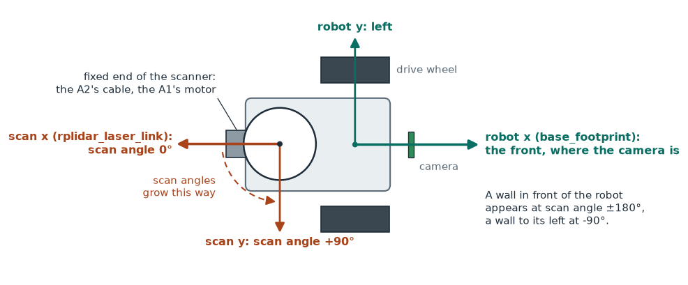

# remo_description

ROS URDF description package of REMO robot (Research Education Mobile/Modular robot) a highly modifiable and extendable mobile robot based on [Nvidia's Jetbot](https://github.com/NVIDIA-AI-IOT/jetbot). This repository contains the stl files to 3D print Remo robot.


## Mesh Files

Remo's model takes the meshes of its parts from two places.

### Purchased parts: robot_component_models

The Raspberry Pi 4 B, the Jetson Nano, the breadboard, the Teensy 4.0, the RPLIDAR A2 and A1, the Raspberry Pi camera and the drive wheels are meshes of the package [robot_component_models](https://github.com/ros-mobile-robots/robot_component_models). This package has display models of off-the-shelf robot components, made from public datasheets, drawings and photos. Remo uses its COLLADA files (`.dae`), which are in metres and have their own colours. With the package in the workspace, RViz and Gazebo show these parts without any other files.

`remo_description` needs the package in the same catkin workspace. From the workspace's root, clone the package next to `remo_description`, at the version that this model uses:

```bash
git clone --branch 1.0.0 https://github.com/ros-mobile-robots/robot_component_models.git src/robot_component_models
```

Then build the workspace, for example with `catkin build`, and source its `devel/setup.bash` again.

[`remo_robot.repos`](remo_robot.repos) lists the package at the same version. This file lists the repositories of a workspace on Remo's Raspberry Pi, for [`vcs import`](https://github.com/dirk-thomas/vcstool). One of them is the camera driver `raspicam_node`, which requires the Raspberry Pi's camera libraries. In the diffbot repository's dev container, rosdep can't resolve its dependency `libraspberrypi0`, and `rosdep install` stops with `Cannot locate rosdep definition for [libraspberrypi0]`. To add robot_component_models to a development workspace, use the clone command above.

Without the package in the workspace:

- `rosdep install` stops with `Cannot locate rosdep definition for [robot_component_models]`.
- The xacro file still expands.
- RViz shows the robot without these parts and logs `Could not load resource [package://robot_component_models/...]` for each of them.
- Gazebo doesn't load the robot. The node `spawn_model` of `gazebo_ros` stops with `Package[robot_component_models] does not have a path` and `Spawn service failed`.

### STL Mesh Files

The STL files in [`meshes/`](meshes) are empty placeholders. They stand for Remo's 3D printed parts, such as the chassis, the decks, the lidar platform and the camera mounts, and for the parts that robot_component_models doesn't have, such as the motors, the battery pack and the OAK cameras.

This repository does not include the STL mesh files due to size and licensing.

To obtain the mesh files:

1. [Purchase / Register](https://fjp.gumroad.com/l/GnMpU)
2. Download the provided `stl_download_config.yaml`
3. Run:

```bash
pip install pyyaml requests
python3 scripts/download_assets.py
```

## Camera Types

The [`remo.urdf.xacro`](urdf/remo.urdf.xacro) accepts a `camera_type`
[xacro arg](http://wiki.ros.org/xacro#Rospack_commands) which lets you choose between the following different camera types

| Raspicam v2 with IMX219 | OAK-1 | OAK-D |
|:-----------------------:|:-----:|:-----:|
| [](https://raw.githubusercontent.com/ros-mobile-robots/ros-mobile-robots.github.io/main/docs/resources/remo/camera_types/raspi-cam.png) | [](https://raw.githubusercontent.com/ros-mobile-robots/ros-mobile-robots.github.io/main/docs/resources/remo/camera_types/oak-1.png) | [](https://raw.githubusercontent.com/ros-mobile-robots/ros-mobile-robots.github.io/main/docs/resources/remo/camera_types/oak-d.png) |

## Single Board Computer Types

Another xacro argument is the `sbc_type` wher you can select between `jetson` and `rpi`.

| Jetson Nano | Raspberry Pi 4 B |
|:-----------------------:|:-----:|
| [](https://raw.githubusercontent.com/ros-mobile-robots/ros-mobile-robots.github.io/main/docs/resources/remo/sbc_types/jetson-nano.png) | [](https://raw.githubusercontent.com/ros-mobile-robots/ros-mobile-robots.github.io/main/docs/resources/remo/sbc_types/raspi.png) |

## Lidar Types

The xacro argument `lidar_type` selects the laser scanner and its printed platform: `'a2'` (the default) or `'a1'`.

| `lidar_type` | Laser scanner | Printed platform |
|:-------------|:--------------|:-----------------|
| `'a2'` | Slamtec RPLIDAR A2 | `platfom_rplidar_a2.stl` |
| `'a1'` | Slamtec RPLIDAR A1 | `platform_rplidar_a1.stl` |

The scan's frame is `rplidar_laser_link`. This frame lies on the scanner's rotation axis, in the scan plane. The picture shows the scan's frame and the robot's frame from above:



The scan's x axis points to the robot's rear with both types, where the A2 has its cable and the A1 its motor. [rplidar_ros](https://github.com/Slamtec/rplidar_ros), the scanners' driver, publishes the scan in such a frame, with the scan angle 0 along the x axis. So a wall in front of the robot appears at a scan angle of ±180°.

The two types differ in these frames and simulation values. All other frames are the same:

| | `'a2'` | `'a1'` |
|:--|:--|:--|
| `rplidar_laser_link` on `lidar_platform_link` | `0.002 0.0 0.07` m | `0.0052 0.0006 0.071` m: 3.2 mm further to the front, 0.6 mm further to the left, 1 mm higher |
| `slamtec_holder_link` and `slamtec_usb_to_serial_link`, the USB adapter and its holder on the platform's left side | | 2 mm higher |
| Shortest and longest distance of the simulated scanner | 0.1 m and 30 m | 0.15 m and 12 m |
| Scans per second of the simulated scanner | 12 | 5.5 |

Each type's values are in [`config/remo/sensors.yaml`](config/remo/sensors.yaml) (`laser`) and [`config/remo/base.yaml`](config/remo/base.yaml) (`lidar_platform`), under the key `types`. The comments there say which values come from Slamtec's datasheets and which are simulation settings.

## Selecting the Types and Checking the Result

The model has three xacro arguments for its types:

| xacro argument | Values | Default |
|:---------------|:-------|:--------|
| `camera_type` | `'raspi-cam'`, `'oak-1'`, `'oak-d'` | `'raspi-cam'` |
| `sbc_type` | `'rpi'`, `'jetson'` | `'rpi'` |
| `lidar_type` | `'a2'`, `'a1'` | `'a2'` |

Each value has its own quotes, so put each argument in double quotes on the command line. From a sourced workspace, these commands expand the model with the Jetson Nano, the Raspberry Pi camera and the RPLIDAR A1, check the URDF and show it in RViz:

```bash
xacro "$(rospack find remo_description)/urdf/remo.urdf.xacro" \
  "sbc_type:='jetson'" "camera_type:='raspi-cam'" "lidar_type:='a1'" > /tmp/remo.urdf
check_urdf /tmp/remo.urdf
roslaunch remo_description view_remo.launch urdf_file:="cat /tmp/remo.urdf"
```

`check_urdf` comes with Ubuntu's package `liburdfdom-tools`. `view_remo.launch` expands the default model, unless `urdf_file` names another command that prints a URDF, here the saved file. For the lidar type alone, the launch file has an argument of its own, without the inner quotes:

```bash
roslaunch remo_description view_remo.launch lidar_type:=a1
```

The scanner's joint in the saved file tells which lidar type the model has. This command prints the joint:

```bash
grep -A 3 'joint name="rplidar_laser_joint"' /tmp/remo.urdf
```

With `'a1'`, the joint's origin is `xyz="0.0052 0.0006 0.071"` on `lidar_platform_link`, with a yaw of π (`rpy="0 0 3.14159…"`). With `'a2'`, the origin is `xyz="0.002 0.0 0.07"`, with the same yaw. With the public repositories alone, RViz shows the scanner. The printed platform under the scanner needs the [STL mesh files](#stl-mesh-files).

### Checking the Simulated Scan

In Gazebo, the model publishes the laser scan on the topic `/diffbot/scan`. The first command starts Gazebo with an empty world. The other two, in a second terminal, load the saved URDF as the parameter `/diffbot/robot_description`, where the model's Gazebo plugin for the wheels' controllers reads it, and put the robot into the world:

```bash
roslaunch gazebo_ros empty_world.launch
```

```bash
rosparam set -t /tmp/remo.urdf /diffbot/robot_description
rosrun gazebo_ros spawn_model -urdf -param /diffbot/robot_description -model remo
```

| What to check | Command | `'a2'` | `'a1'` |
|:--------------|:--------|:-------|:-------|
| The scan's frame | `rostopic echo -n 1 /diffbot/scan/header/frame_id` | `rplidar_laser_link` | `rplidar_laser_link` |
| The shortest distance in metres | `rostopic echo -n 1 /diffbot/scan/range_min` | 0.1 | 0.15 |
| The longest distance in metres | `rostopic echo -n 1 /diffbot/scan/range_max` | 30 | 12 |
| The scans per second | `rostopic hz /diffbot/scan` | about 11.9 | about 5.5 |
| The direction | Put a box 1 m in front of the robot with the box button of Gazebo's toolbar, then `rostopic echo -n 1 /diffbot/scan/ranges` | The list runs from scan angle -180° to +180°. The box's distances, about 1 m, are at the list's start and end | The same |

The diffbot repository's drive test, `sim_drive_remo.test`, doesn't read the scan. The test passes with any range and scan rate, so these commands are the check of the simulated scanner.


## Usage

This is a ROS package which should be cloned in a catkin workspace.
To use `remo_description` inside a Gazebo simulation or on a real 3D printed Remo robot, you can directly make use of the ROS packages in the 
[ros-mobile-robots/diffbot](https://github.com/ros-mobile-robots/diffbot) repository. 
Most of the launch files you find in the `diffbot` repository
accept a `model` argument. Just append `model:=remo` to the end of a `roslaunch` command to make use of this `remo_description` package.

### Assembly

For assembly instructions please watch the video below:

[](https://youtu.be/6aAEbtfVbAk)

### Git LFS and Bandwith Quota

The binary stl files are hosted on GitHub using [Git Large File Storage (git lfs)](https://git-lfs.github.com/) 
to avoid increasing the total size of the repository because of possible stl file changes.
For open source repositories, GitHub has a bandwith limit of 1 GB (up to 1.5 GB) per month. 
Depending on how many users clone/pull the stl files using git lfs per month, this bandwith can be exhausted after a few days. 
If you are not able to clone/pull the stl files and only get the pointer files, you have to wait until the bandwith quota resets back to zero. 
In case you need the stl files immediately, and to support this work you can get [immediate access to the stl files](https://gumroad.com/l/GnMpU?wanted=true):

<a class="gumroad-button" href="https://gumroad.com/l/GnMpU?wanted=true" data-gumroad-single-product="true">Access Remo STL files</a>

Also if you find this work useful please consider the funding options to support the development and design of this robot.
However, you will always be able to clone/pull and use the Remo stl files once the bandwith quota resets.


## Contributing

You addons to Remo are most welcome, feel free to open a discussion/issue or directly create a pull request.

## :handshake: Acknowledgment

- [Louis Morandy-Rapiné](https://louisrapine.com/) for his great work on REMO robot and designing it in [Fusion 360](https://www.autodesk.com/products/fusion-360/overview).


## License

`remo_description` is licenses under the [BSD-3 clause](./LICENSE).
See also [open-source-license-acknowledgements-and-third-party-copyrights.md](open-source-license-acknowledgements-and-third-party-copyrights.md).
